# 🏛️ Arquitectura Técnica de StageFlow AI

> Documentación técnica profunda del motor agentivo multimodal y flujo de datos de punta a punta.

---

## 📋 Tabla de Contenidos

1. [Visión General de la Arquitectura](#visión-general-de-la-arquitectura)
2. [Agente Autónomo Multimodal (Fase 3.2)](#agente-autónomo-multimodal-fase-32)
   - [Patrón ReAct: Percepción-Razonamiento-Acción](#patrón-react-percepción-razonamiento-acción)
   - [Bucle Agentivo Principal](#bucle-agentivo-principal)
   - [Percepción (Gemini Vision API)](#percepción-gemini-vision-api)
   - [Razonamiento Semántico](#razonamiento-semántico)
   - [Acción (Playwright Engine)](#acción-playwright-engine)
   - [Human-in-the-Loop (Seguridad)](#human-in-the-loop-seguridad)
3. [Perfil Único JSON (Fase 2)](#perfil-único-json-fase-2)
   - [Esquema de Datos Estándar](#esquema-de-datos-estándar)
   - [Endpoint de Pre-evaluación](#endpoint-de-pre-evaluación)
4. [Integración Frontend ↔ Backend (Fase 1 + 4)](#integración-frontend--backend-fase-1--4)
   - [Stack Tecnológico del Frontend](#stack-tecnológico-del-frontend)
   - [Flujo del Modal Wizard](#flujo-del-modal-wizard)
   - [Arquitectura de Componentes](#arquitectura-de-componentes)
5. [Diagramas de Flujo](#diagramas-de-flujo)
6. [API Reference](#api-reference)

---

## 🌐 Visión General de la Arquitectura

StageFlow AI implementa una arquitectura **monolítica modular** basada en Next.js App Router, donde el frontend y el backend coexisten en el mismo proyecto pero con responsabilidades claramente separadas.

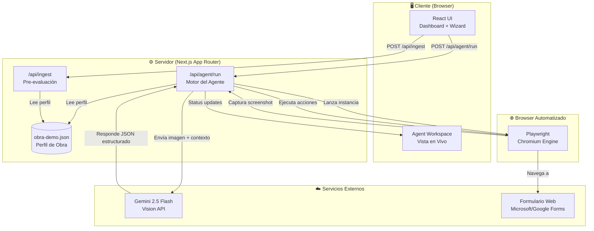

---

## 🤖 Agente Autónomo Multimodal (Fase 3.2)

El corazón de StageFlow AI es un **agente autónomo multimodal** que combina:
- **Visión por Computadora** (Gemini Vision API)
- **Control de Navegador** (Playwright)
- **Razonamiento Contextual** (Prompt Engineering)

### Patrón ReAct: Percepción-Razonamiento-Acción

El agente implementa el patrón de diseño **ReAct (Reasoning + Acting)**, un ciclo iterativo de tres fases:

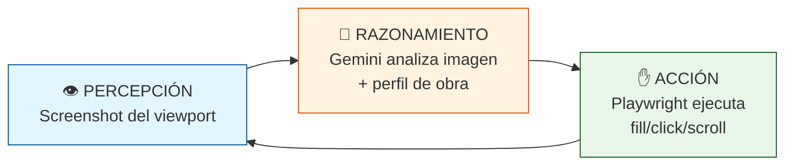

### Bucle Agentivo Principal

El bucle principal se encuentra en `app/api/agent/run/route.ts` y opera de la siguiente manera:

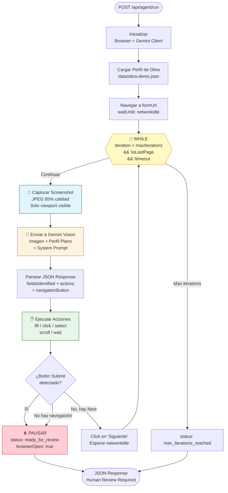

#### Código del Bucle Principal

```typescript
// app/api/agent/run/route.ts (líneas 468-543)

while (iteration < maxIterations && !isLastPage) {
  // Verificar timeout global
  if (Date.now() - startTime > timeoutMs) {
    console.warn("Timeout global alcanzado");
    break;
  }

  iteration++;
  
  // 1. PERCEPCIÓN: Capturar screenshot
  const { resultado, geminiResponse } = await procesarPagina(
    page,
    genai,
    perfilPlano,
    iteration
  );

  pages.push(resultado);
  
  // 2. Verificar si es la última página (botón Submit)
  if (geminiResponse.isLastPage || 
      geminiResponse.navigationButton.type === "submit") {
    console.log("[Agente] Página final detectada - PAUSA");
    isLastPage = true;
    break;  // 🛡️ Human-in-the-loop: NO enviar automáticamente
  }

  // 3. ACCIÓN: Navegar a siguiente página si existe
  if (geminiResponse.navigationButton.detected &&
      geminiResponse.navigationButton.type === "next") {
    await ejecutarAccion(page, {
      type: "click",
      selector: geminiResponse.navigationButton.selector,
      description: "Clic en botón siguiente",
    });
    await page.waitForTimeout(2000);
  }
}
```

---

### Percepción (Gemini Vision API)

La fase de **Percepción** captura el estado visual actual del formulario:

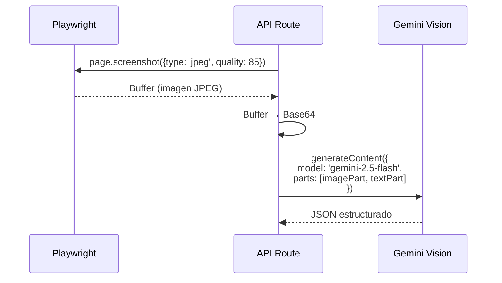

#### Configuración del Screenshot

```typescript
async function capturarPantalla(page: Page): Promise<Buffer> {
  return await page.screenshot({
    type: "jpeg",
    quality: 85,        // Balance calidad/tamaño
    fullPage: false,    // Solo viewport visible (1280x800)
  });
}
```

#### System Prompt para Gemini Vision

El prompt de sistema instruye a Gemini para:
1. Identificar TODOS los campos visibles en la imagen
2. Sugerir selectores CSS/XPath robustos
3. Mapear campos a datos del perfil de la obra
4. Detectar botones de navegación ("Siguiente", "Enviar")

```typescript
const VISION_SYSTEM_PROMPT = `Eres un agente de automatización...

REGLAS IMPORTANTES:
- Identifica TODOS los campos visibles en la imagen
- Prioriza selectores robustos: id > name > aria-label > placeholder
- Detecta botones: "Siguiente", "Next", "Enviar", "Submit"
- Si detectas "Enviar"/"Submit", marca isLastPage como true

FORMATO DE RESPUESTA: JSON válido...`;
```

---

### Razonamiento Semántico

Gemini analiza la imagen en conjunto con el **Perfil Plano de la Obra** para producir un mapeo semántico inteligente:

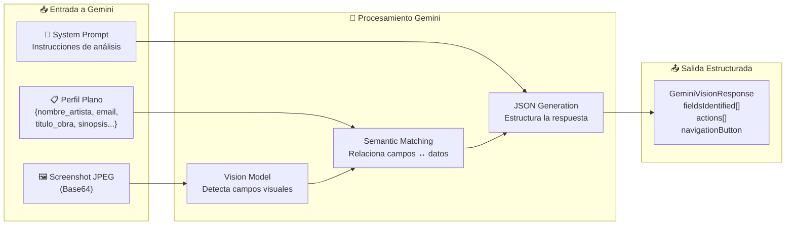

#### Estructura de Respuesta de Gemini

```typescript
interface GeminiVisionResponse {
  pageDescription: string;
  fieldsIdentified: Array<{
    fieldLabel: string;           // "Nombre de la compañía"
    fieldType: "text" | "email" | "textarea" | "select" | ...;
    suggestedSelector: string;    // "#company-name" o "[name='company']"
    matchingObraField: string;    // "nombre_artista"
    valueToFill: string;          // "Monte Virgen"
  }>;
  actions: GeminiAction[];
  navigationButton: {
    detected: boolean;
    type: "next" | "submit" | "none";
    selector: string | null;
    buttonText: string | null;
  };
  isLastPage: boolean;
  confidence: number;             // 0.0 - 1.0
}
```

---

### Acción (Playwright Engine)

Playwright ejecuta las acciones determinadas por Gemini sobre el DOM real:

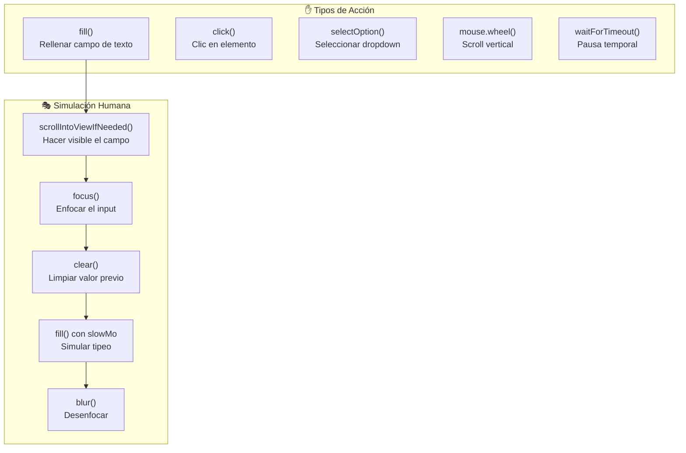

#### Código de Ejecución de Acciones

```typescript
async function ejecutarAccion(
  page: Page,
  action: GeminiAction
): Promise<{ success: boolean; error?: string }> {
  try {
    switch (action.type) {
      case "fill":
        // Secuencia que simula comportamiento humano
        await page.locator(action.selector).first().scrollIntoViewIfNeeded();
        await page.locator(action.selector).first().focus();
        await page.waitForTimeout(100);  // Pausa realista
        await page.locator(action.selector).first().clear();
        await page.locator(action.selector).first().fill(action.value);
        await page.locator(action.selector).first().blur();
        return { success: true };
        
      case "click":
        await page.locator(action.selector).first().scrollIntoViewIfNeeded();
        await page.locator(action.selector).first().click();
        return { success: true };
        
      // ... otros casos
    }
  } catch (error) {
    return { success: false, error: error.message };
  }
}
```

#### Configuración de Playwright

```typescript
// Lanzar navegador en modo VISIBLE (desarrollo)
browser = await chromium.launch({
  headless: false,    // 👁️ Permite auditar visualmente las acciones
  slowMo: 50,         // 🐢 50ms de delay entre acciones
});

// Configurar contexto con viewport estándar
const context = await browser.newContext({
  viewport: { width: 1280, height: 800 },
  userAgent: "Mozilla/5.0 (Windows NT 10.0; Win64; x64)..."
});
```

---

### Human-in-the-Loop (Seguridad)

**CRÍTICO**: El agente NUNCA envía formularios automáticamente.

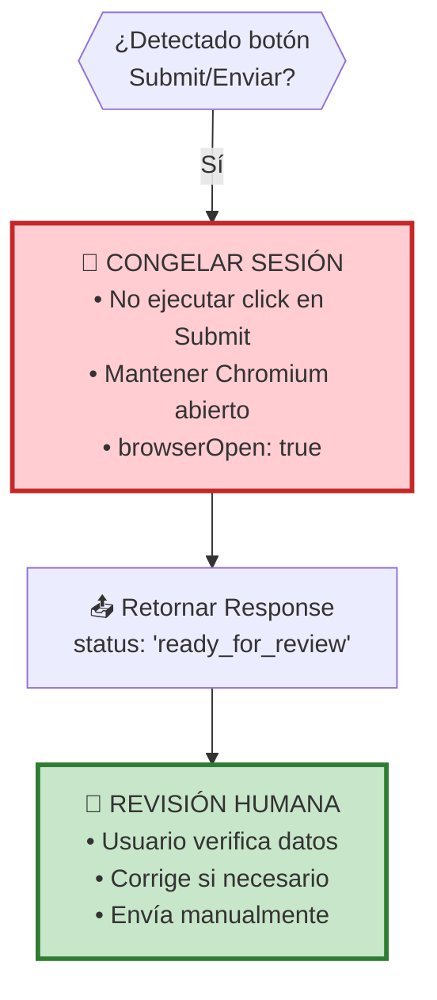

#### Estados de Respuesta del Agente

| Status | Descripción | browserOpen |
|--------|-------------|-------------|
| `ready_for_review` | Formulario completo, listo para revisión humana | `true` |
| `completed` | Todas las páginas procesadas sin botón Submit | `true` |
| `max_iterations_reached` | Límite de iteraciones alcanzado | `true` |
| `error` | Error fatal durante ejecución | `false` |

---

## 📄 Perfil Único JSON (Fase 2)

### Esquema de Datos Estándar

El archivo `data/obra-demo.json` es la **fuente de verdad** para los datos de la obra:

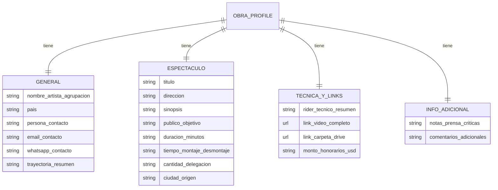

#### TypeScript Interface

```typescript
interface ObraProfile {
  general: {
    nombre_artista_agrupacion: string;
    pais: string;
    persona_contacto: string;
    email_contacto: string;
    whatsapp_contacto: string;
    trayectoria_resumen: string;
  };
  espectaculo: {
    titulo: string;
    direccion: string;
    sinopsis: string;
    publico_objetivo: string;
    duracion_minutos: string;
    tiempo_montaje_desmontaje: string;
    cantidad_delegacion: string;
    ciudad_origen: string;
  };
  tecnica_y_links: {
    rider_tecnico_resumen: string;
    link_video_completo: string;
    link_carpeta_drive: string;
    monto_honorarios_usd: string;
  };
  informacion_adicional: {
    notas_prensa_criticas: string;
    comentarios_adicionales: string;
  };
}
```

#### Aplanamiento del Perfil

Antes de enviar a Gemini, el perfil se aplana a un objeto simple:

```typescript
function aplanarPerfilObra(obra: ObraProfile): Record<string, string> {
  return {
    // General
    "nombre_artista": obra.general.nombre_artista_agrupacion,
    "email": obra.general.email_contacto,
    "pais": obra.general.pais,
    // Espectáculo
    "titulo_obra": obra.espectaculo.titulo,
    "sinopsis": obra.espectaculo.sinopsis,
    "duracion": obra.espectaculo.duracion_minutos,
    // Técnica
    "video_link": obra.tecnica_y_links.link_video_completo,
    "drive_link": obra.tecnica_y_links.link_carpeta_drive,
    "honorarios": obra.tecnica_y_links.monto_honorarios_usd,
    // ... más campos
  };
}
```

---

### Endpoint de Pre-evaluación

`/api/ingest` analiza la compatibilidad entre la obra y una convocatoria ANTES de ejecutar el agente:

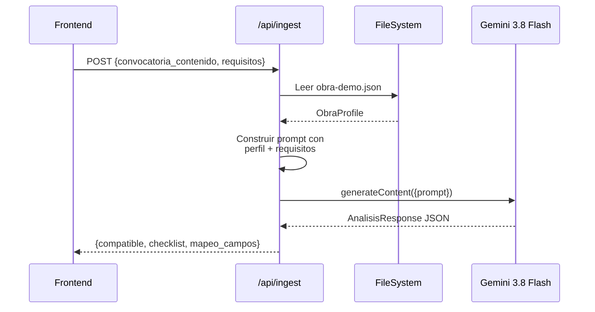

#### Estructura de Respuesta del Ingest

```typescript
interface AnalisisResponse {
  compatible: boolean;              // ¿La obra cumple requisitos?
  checklist: Array<{
    requisito: string;              // "Duración entre 50-90 min"
    cumple: boolean;
    detalle: string;                // "Obra actual: 60 min · Cumple"
  }>;
  mapeo_campos: Array<{
    pregunta_id: string;
    label: string;                  // "Nombre de la compañía"
    valor_inyectar: string;         // "Monte Virgen"
  }>;
}
```

---

## 🎨 Integración Frontend ↔ Backend (Fase 1 + 4)

### Stack Tecnológico del Frontend

| Tecnología | Uso |
|------------|-----|
| **Next.js 16.4** | App Router, Server Components, API Routes |
| **React 19** | UI Components con hooks modernos |
| **Tailwind CSS 4** | Utility-first styling |
| **shadcn/ui** | Componentes accesibles pre-estilizados |
| **Lucide Icons** | Iconografía consistente |
| **next-themes** | Dark/Light mode |

### Flujo del Modal Wizard

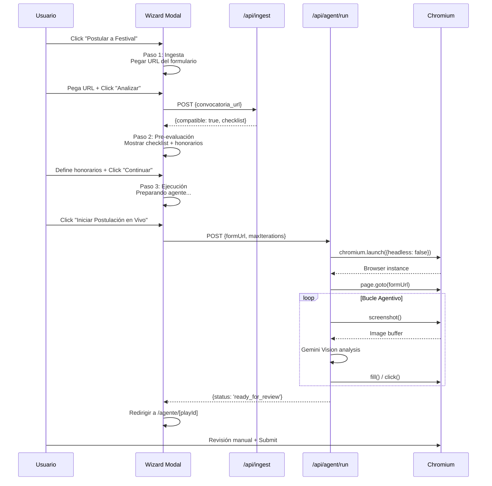

### Arquitectura de Componentes

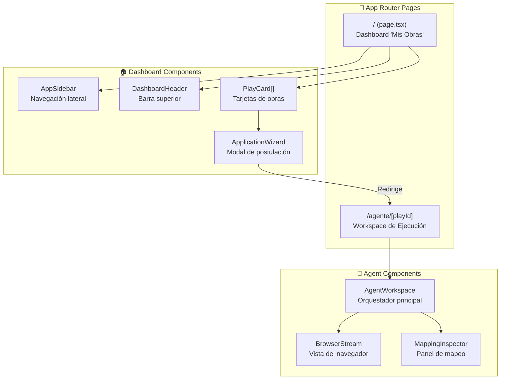

#### Componente ApplicationWizard

El wizard tiene 3 pasos (`components/dashboard/application-wizard.tsx`):

```typescript
const STEPS = [
  { id: 1, label: 'Convocatoria' },   // IngestStep
  { id: 2, label: 'Pre-evaluación' }, // AnalysisStep  
  { id: 3, label: 'Ejecución' },      // ExecutionStep
] as const
```

**Paso 1 - IngestStep:**
- Input para URL del formulario (Microsoft/Google Forms)
- Drag & drop para PDF de bases
- Validación de URL con regex

**Paso 2 - AnalysisStep:**
- Muestra checklist de compatibilidad
- Permite definir honorarios USD
- Barra de progreso de compatibilidad

**Paso 3 - ExecutionStep:**
- Animación de preparación del agente
- Botón "Iniciar Postulación en Vivo"
- Redirige a `/agente/[playId]`

#### Componente AgentWorkspace

Orquesta la experiencia de ejecución en vivo (`components/agent/agent-workspace.tsx`):

```typescript
export type AgentMode = 'running' | 'paused' | 'manual'

// Estados del workspace
const [cursor, setCursor] = useState(firstPendingIndex) // Campo actual
const [mode, setMode] = useState<AgentMode>('running')
const [overrides, setOverrides] = useState<Record<string, string>>({})
const [sent, setSent] = useState(false)
```

**Modos de operación:**
- `running`: Agente escribiendo automáticamente
- `paused`: Agente pausado, usuario puede observar
- `manual`: Control entregado al usuario para edición

---

## 📊 Diagramas de Flujo

### Flujo Completo End-to-End

```mermaid
flowchart TB
    subgraph Usuario["👤 Usuario"]
        U1[Selecciona obra]
        U2[Pega URL formulario]
        U3[Revisa checklist]
        U4[Inicia agente]
        U5[Revisa y envía]
    end
    
    subgraph Frontend["🖥️ Frontend"]
        F1[Dashboard]
        F2[Wizard Modal]
        F3[Agent Workspace]
    end
    
    subgraph Backend["⚙️ Backend"]
        B1[/api/ingest]
        B2[/api/agent/run]
    end
    
    subgraph AI["🤖 AI + Automation"]
        A1[Gemini Flash<br/>Pre-eval]
        A2[Gemini Vision<br/>Análisis visual]
        A3[Playwright<br/>Automatización]
    end
    
    U1 --> F1
    F1 --> F2
    U2 --> F2
    F2 -->|POST| B1
    B1 --> A1
    A1 --> B1
    B1 --> F2
    U3 --> F2
    F2 --> F3
    U4 --> F3
    F3 -->|POST| B2
    B2 --> A3
    
    loop Bucle ReAct
        A3 -->|screenshot| A2
        A2 -->|acciones| A3
    end
    
    A3 --> B2
    B2 --> F3
    U5 --> A3
```

### Diagrama de Estados del Agente

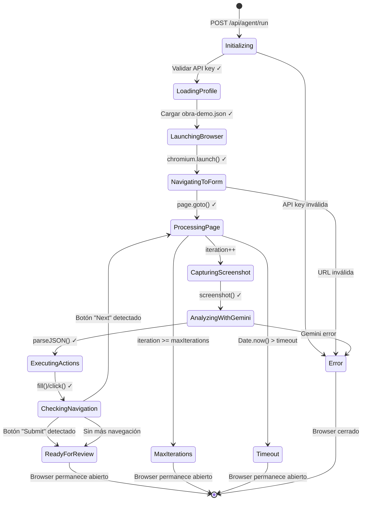

---

## 📚 API Reference

### POST /api/agent/run

Ejecuta el agente autónomo de llenado de formularios.

**Request Body:**
```typescript
interface AgentRunRequest {
  formUrl: string;        // URL del formulario (requerido)
  maxIterations?: number; // Máximo de páginas (default: 20)
  timeoutMs?: number;     // Timeout global en ms (default: 300000)
}
```

**Response:**
```typescript
interface AgentRunResponse {
  status: "ready_for_review" | "completed" | "error" | "max_iterations_reached";
  pagesProcessed: number;
  totalFieldsCompleted: number;
  totalFieldsFound: number;
  pages: PaginaProcesada[];
  browserOpen: boolean;
  error?: string;
  executionTimeMs: number;
}
```

### POST /api/ingest

Pre-evalúa la compatibilidad de una obra con una convocatoria.

**Request Body:**
```typescript
interface IngestRequestBody {
  convocatoria_contenido?: string;  // Texto de la convocatoria
  convocatoria_url?: string;        // O URL de la convocatoria
  requisitos?: {
    duracion_min?: number;
    duracion_max?: number;
    paises_permitidos?: string[];
    requiere_video?: boolean;
    requiere_dossier?: boolean;
  };
}
```

**Response:**
```typescript
{
  success: boolean;
  obra: string;           // Nombre de la agrupación
  titulo_obra: string;    // Título de la obra
  analisis: {
    compatible: boolean;
    checklist: ChecklistItem[];
    mapeo_campos: MapeoCampo[];
  };
}
```

---

## 🔧 Variables de Entorno

| Variable | Requerida | Descripción |
|----------|-----------|-------------|
| `GEMINI_API_KEY` | ✅ | API Key de Google Gemini |

---

## 📁 Archivos Clave

| Archivo | Líneas | Descripción |
|---------|--------|-------------|
| `app/api/agent/run/route.ts` | ~630 | Motor del agente autónomo |
| `app/api/ingest/route.ts` | ~220 | Pre-evaluación de elegibilidad |
| `data/obra-demo.json` | ~30 | Perfil estándar de la obra |
| `lib/form-mapping.ts` | ~140 | Mapeo obra → formulario |
| `components/dashboard/application-wizard.tsx` | ~540 | Wizard de postulación |
| `components/agent/agent-workspace.tsx` | ~170 | Workspace de ejecución |
| `components/agent/browser-stream.tsx` | ~220 | Visualización del navegador |

---

<div align="center">

**Última actualización:** Octubre 2026 · **Versión:** 2.0.0

</div>
